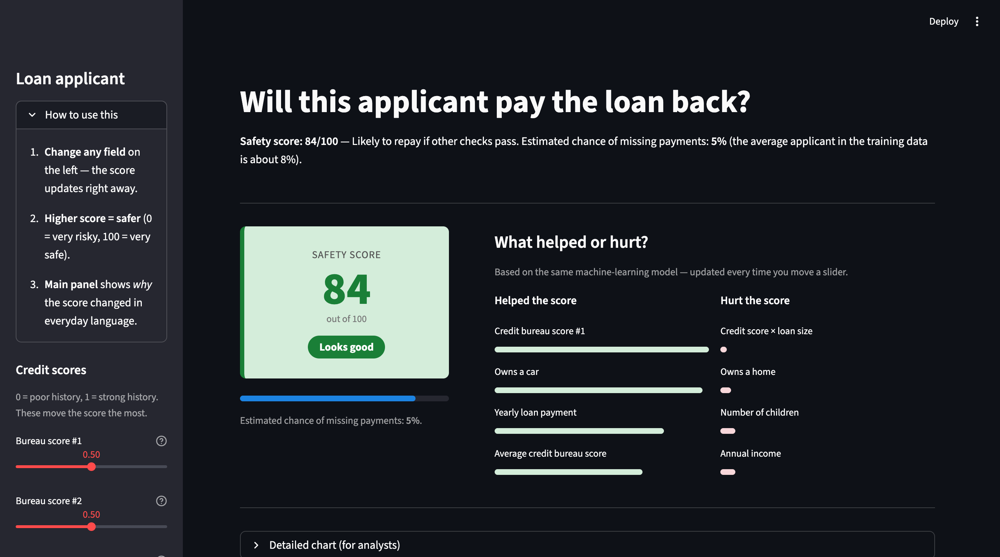

# Home Credit Risk Scorer

A production-style credit risk scoring system built on the [Kaggle Home Credit Default Risk](https://www.kaggle.com/competitions/home-credit-default-risk/data) dataset (~300,000 applicants). An XGBoost model is trained and evaluated on a held-out test set. A SHAP explainability layer shows exactly which factors drove each prediction. A business rules engine enforces hard policy caps on top of the model output — mirroring how real credit scoring systems work at lenders and bureaus.

The model is served by a FastAPI scoring API. A Streamlit dashboard calls that API, so you can adjust any applicant input and see the score, explanation, and any triggered policy rules update instantly. The repo has 29 pytest tests (run locally) and a `ruff.toml` lint config.



---

## Results

Evaluated on a held-out 20% test set. The decision threshold is tuned to maximise F1 on the ~8% default rate — not left at the default 0.5 cutoff.

Thresholds are tuned on a 15% slice held out from the training set, never on the test set.

| Model | ROC-AUC | F1 | Precision | Recall |
|---|---|---|---|---|
| XGBoost | 0.7581 | 0.3102 | 0.2430 | 0.4286 |

ROC-AUC of 0.758 means the model correctly ranks a random defaulter as riskier than a random non-defaulter 75.8% of the time. Top Kaggle scores on this competition are ~0.80; this model is lower because it deliberately uses only 24 features that the dashboard/API can supply (an earlier 62-feature version, which also used gender and tables the API never received, scored 0.778).

---

### Calibration

`scale_pos_weight` makes XGBoost over-predict default, so its raw probabilities are far too high. An isotonic-regression calibrator (`models/calibrator.pkl`) is fitted on the 15% slice of training data that XGBoost never saw, and the API's `default_probability` uses it. Checked on the held-out test set:

| | Average predicted default | Brier score (lower is better) |
|---|---|---|
| Raw XGBoost | 39.3% | 0.185 |
| Calibrated | 7.9% | 0.068 |

The actual default rate on the test set is 8.1%. ROC-AUC is unchanged (the calibrator is monotonic). The SHAP waterfall explains the raw model output, so its bars are not in calibrated-probability units.

The 0–100 safety score is derived from the calibrated default chance (`100 × (1 − chance / 0.30)`, so a 30%+ chance scores 0), and the risk bands use cut-offs of 70 and 40. On the held-out test set (61,503 applicants):

| Band | Share of applicants | Actual default rate |
|---|---|---|
| Looks good (70+) | 70% | 4.0% |
| Needs review (40–69) | 19% | 12.3% |
| High risk (below 40) | 11% | 26.7% |

---

## Architecture

```
data/
├── application_train.csv  ─┐
└── bureau.csv             ─┴──▶ src/data_prep.py ──▶ src/train.py ──▶ models/xgboost.pkl
                                  (join, clean,       (XGBoost,
                                   encode, engineer)   tune threshold)
                                           │
                                           ▼
                                    src/explain.py ──▶ outputs/shap_*.png
                                           │
                                           ▼
                              api.py (FastAPI, POST /predict)
                          model score + guardrails + top SHAP reasons
                                           │  HTTP
                                           ▼
                              app.py (Streamlit dashboard)
                        sidebar inputs, score, SHAP waterfall, policy alerts
```

---

## File Guide

| File | What it does |
|---|---|
| `src/data_prep.py` | Loads 2 CSV tables (application, bureau), joins on applicant ID, cleans anomalies, encodes categoricals, engineers ratio and interaction features, splits train/test |
| `src/train.py` | Trains XGBoost; tunes the decision threshold; fits the probability calibrator; saves the model, calibrator and metrics |
| `src/explain.py` | Computes SHAP values on XGBoost; saves global summary and per-applicant waterfall charts |
| `src/score.py` | Turns API input into model features, scores with XGBoost, applies guardrails, picks top SHAP reasons, and holds the plain-English feature labels |
| `src/guardrails.py` | Business rules engine (policy caps) |
| `api.py` | FastAPI service — `GET /health`, `POST /predict` with input validation |
| `app.py` | Streamlit dashboard — sidebar inputs → calls the API → score, SHAP waterfall, policy alerts |
| `notebooks/eda.ipynb` | Exploratory data analysis: default rate by credit score, age, income, loan-to-income, loan type, education and bureau history, with takeaways. Outputs are saved in the notebook, so it renders on GitHub |
| `tests/` | 29 pytest tests (data prep, training, guardrails, SHAP, API) using synthetic data |
| `outputs/` | `metrics.csv`, `feature_cols.json`, SHAP charts |
| `models/` | `xgboost.pkl` (2.2MB) and `calibrator.pkl` are committed (used by the API and its tests); regenerate with `python src/train.py` |

---

## Two-Layer Scoring System

**Layer 1 — ML model (XGBoost)**
Trained on 300K applicants. Key feature groups:
- External credit scores (`EXT_SOURCE_1/2/3`) — strongest individual predictors
- Interaction features (`EXT_MEAN × ANNUITY_INCOME_RATIO`, `DEBT_STRESS`) — teach the model that a good credit score does not override an impossible repayment burden
- Bureau history — number of past credit records and worst overdue days
- Financial ratios — loan-to-income, repayment-to-income, implied loan term

**Layer 2 — Business rules engine**
Hard policy caps applied after the model score, matching how production credit systems at lenders and bureaus work:

| Rule | Condition | Action |
|---|---|---|
| Repayments exceed income | `annuity / income > 1.0` | Cap score at 30 |
| Severe repayment burden | `annuity / income > 0.5` | Cap score at 55 |
| Extreme loan-to-income | `loan / income > 10×` | Cap score at 45 |
| Serious overdue history | `bureau_max_overdue > 60 days` | Reduce score by 15 |

The UI shows the raw model score and the policy-adjusted score separately, with the triggered rules listed explicitly — making the system auditable.

---

## Setup

**1. Install dependencies** (Python 3.13)
```bash
python3.13 -m venv .venv
.venv/bin/pip install -r requirements.txt
```

**2. Download data from Kaggle**

[kaggle.com/competitions/home-credit-default-risk/data](https://www.kaggle.com/competitions/home-credit-default-risk/data) — download into `data/`:
- `application_train.csv`
- `bureau.csv`

**3. Train the model**
```bash
python src/train.py
```

**4. Generate SHAP charts**
```bash
python src/explain.py
```

**5. Start the API, then the dashboard** (two terminals)
```bash
.venv/bin/uvicorn api:app --reload
.venv/bin/streamlit run app.py
```
API at `http://localhost:8000`, dashboard at `http://localhost:8501`.

**6. (Optional) Open the EDA notebook** — needs Jupyter (`pip install jupyter`), which is not in `requirements.txt`
```bash
jupyter notebook notebooks/eda.ipynb
```

**7. Run tests**
```bash
python -m pytest tests/ -v
```

---

## Key Design Decisions

- **Single scoring path** — only the API loads the model; the dashboard is just a client.
- **Train/serve consistency** — the API runs the exact same `encode_categoricals` and `engineer_features` functions used at training time. `feature_cols.json` ensures column order never drifts.
- **Class imbalance** — 8% default rate handled with `scale_pos_weight` and stratified splitting — not SMOTE.
- **Threshold tuning** — the decision threshold is tuned to maximise F1 rather than using the default 0.5, which is meaningless for imbalanced data.
- **Interaction features** — `EXT_MEAN × ANNUITY_INCOME_RATIO` and `DEBT_STRESS` were added after discovering the base model scored a borrower with 267% debt-to-income as Low Risk purely because external scores were high.
- **Explainability** — `TreeExplainer` SHAP gives both a global view (which features matter most across all applicants) and a local view (what drove this specific score). Required in production credit systems for adverse action notices.

---

## Known Limitations

- **Score scale and band cut-offs are my own choice.** The 0–100 score is `100 × (1 − calibrated default chance / 0.30)`, clipped at 0, and the 70 / 40 cut-offs were picked by hand, not tuned. The band results above are measured on the test set, but they depend on that choice.
- **Median imputation is fit on the full dataset** before the train/test split, a small data leak.
- **No fairness analysis.** Gender is not a model input, but other features (e.g. age) could still correlate with protected attributes; no fairness audit has been done.
- **Policy caps are not data-driven.** The EDA notebook shows applicants with loan > 10× income default at 6.8% and with annuity > 50% of income at 7.6%, both below the 8.1% average. The guardrails are lending-policy overrides, not a pattern learned from this data.
- **Annuity units are unconfirmed.** The Kaggle column description says only "Loan annuity" (no period), so the "yearly payment" label in the dashboard and API is an assumption.
- **No hyperparameter search or cross-validation** was run.

---

## Dataset

[Home Credit Default Risk](https://www.kaggle.com/competitions/home-credit-default-risk/data) — provided by Home Credit Group. 307,511 loan applications; the full dataset has 7 related tables and this project uses 2 of them (application and bureau).
